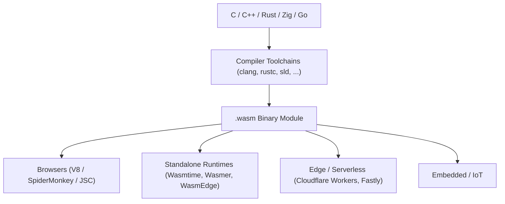

# Chapter 00: Philosophy and Foundations of WebAssembly

> **Author:** Wirot Chookeaw ([`chin6700x`](https://github.com/chin6700x)) • **License:** Apache-2.0 / MIT © 2026  
> **References:** [webassembly.org](https://webassembly.org/) • [MDN WebAssembly](https://developer.mozilla.org/en-US/docs/WebAssembly)

[⬅ Table of Contents](README.md) | [Chapter 01 ➡](01-core-architecture.md)

---

## 0.1 Why WebAssembly?

JavaScript was originally designed as a lightweight dynamic scripting language. While remarkably flexible, it encounters structural bottlenecks when tasked with compute-heavy, predictable workloads:

| Bottleneck | Systems Impact |
| :--- | :--- |
| **Dynamic Typing** | Modern engines must speculate types at runtime (JIT speculation) and frequently deoptimize back to interpreter tiers upon type changes, causing unpredictable throughput. |
| **Garbage Collection (GC)** | Non-deterministic GC collection pauses cause frame drops in gaming, audio signal processing, and real-time visualization. |
| **Monolithic Numeric Type** | Historically, all standard numbers in JS are IEEE 754 float64 values; there are no native int32/int64 storage primitives (aside from slower `BigInt` objects). |
| **JIT Warm-up Latency** | Source text must be fetched, lexed, parsed into an AST, compiled to bytecode, and profiled before machine optimization occurs on every single reload. |
| **Language Lock-in** | Millions of battle-tested lines of C, C++, Rust, Zig, and Go code cannot run natively on the web without translation overhead. |

WebAssembly (abbreviated **Wasm**) resolves these challenges by providing a **portable binary instruction format** that:

- Features a static, hardware-mapped type system (`i32`, `i64`, `f32`, `f64`) that compiles directly and predictably to host CPU instructions.
- Operates without a garbage collector in its core specification (Core 1.0/2.0), granting the developer deterministic control over linear memory.
- Encodes instructions as compact, pre-validated binary bytecode that decodes orders of magnitude faster than parsing text.
- Serves as an open compilation target for high-performance languages including C, C++, Rust, Zig, and Go.

> [!NOTE]
> WebAssembly **does not replace** JavaScript; it augments it. JavaScript orchestrates DOM manipulation, high-level UI, and event handling, while WebAssembly executes computationally intensive workloads at near-native hardware speed.

---

## 0.2 The W3C Open Standard & The Four Tenets

WebAssembly is an official open standard ratified by the **World Wide Web Consortium (W3C)** (reaching W3C Recommendation status in December 2019), co-developed and maintained by major browser vendors (Mozilla, Google, Apple, and Microsoft).

Its foundational architectural goals, as articulated on [webassembly.org](https://webassembly.org/):

1. **Fast** — Executes with near-native performance by leveraging common modern CPU capabilities across architectures.
2. **Safe** — Operates within a memory-isolated, capability-constrained sandbox; execution code is strictly validated before instantiation.
3. **Portable** — The exact same `.wasm` binary executes identically across operating systems and instruction set architectures (x86_64, ARM64, RISC-V).
4. **Compact** — A dense binary format designed for efficient network transmission, streaming decoding, and instantaneous instantiation.

### The Standard Specification Landscape

| Specification | Core Focus |
| :--- | :--- |
| **Core Specification** | Binary encoding, instruction set semantics, formal validation rules, and runtime execution model. |
| **JavaScript Interface** | The host `WebAssembly.*` JavaScript binding layer. |
| **Web API Interface** | Streaming compilation interfaces, such as `instantiateStreaming` via `fetch()`. |
| **WASI (WebAssembly System Interface)** | Modular, capability-oriented POSIX-like system calls for standalone execution outside browsers. |

Primary specification repository: https://webassembly.github.io/spec/core/

---

## 0.3 The WebAssembly Ecosystem



- **In the Browser:** Loaded, instantiated, and interfaced via the JavaScript API (`WebAssembly.instantiate*`).
- **Outside the Browser:** Utilizes **WASI** as an abstract host interface for filesystem, system clock, and network I/O based on explicit capability security tokens.
- **Serverless & Edge Platforms:** Instant microsecond cold-start latency, drastically leaner than Linux container abstractions.

---

## 0.4 Pathways to WebAssembly (The Course Spectrum)

| Pathway | Toolchain | Advantages | Trade-offs |
| :--- | :--- | :--- | :--- |
| **A. Emscripten** | `emcc` | Complete POSIX libc emulation, automatic JS glue. | Heavy runtime overhead, large binary output. |
| **B. Bare-Metal Clang** | `clang --target=wasm32` + `wasm-ld` | Lean, fully inspectable, sub-1KB binaries. | No default libc; runtime routines must be self-written. |
| **C. Sovereign C Emitter** | Example: `sld --target=wasm32` | Maximum conceptual mastery, instant compilation (<20ms). | Features and optimizations implemented by hand. |
| **D. Handcrafted WAT** | `wat2wasm` | Precise byte-level insight into binary mapping. | Impractical for complex applications. |

Chapters 01 through 08 cover the W3C specification that **every pathway must obey**, while Chapters 09 and 10 dive deep into Pathways B and C.

---

## 0.5 Hello Wasm: The Smallest Valid Binary

The smallest valid WebAssembly module according to the W3C specification consists of exactly **8 bytes**:

```text
00 61 73 6D   01 00 00 00
\0  a  s  m   version = 1
```

Testing this minimal binary in Node.js:

```javascript
const bytes = new Uint8Array([0x00, 0x61, 0x73, 0x6D, 0x01, 0x00, 0x00, 0x00]);
console.log(WebAssembly.validate(bytes)); // true
const mod = await WebAssembly.instantiate(bytes);
console.log(mod.instance.exports);        // {}
```

Below is a complete, self-contained module exporting `add(i32, i32) -> i32` (measuring only 41 bytes):

```javascript
const add = new Uint8Array([
  0x00,0x61,0x73,0x6D, 0x01,0x00,0x00,0x00,      // Wasm Header (Magic + Version 1)
  0x01,0x07,0x01,0x60,0x02,0x7F,0x7F,0x01,0x7F,  // Type Section: (i32, i32) -> i32
  0x03,0x02,0x01,0x00,                            // Function Section: 1 function of Type Index 0
  0x07,0x07,0x01,0x03,0x61,0x64,0x64,0x00,0x00,  // Export Section: Export "add" = Function Index 0
  0x0A,0x09,0x01,0x07,0x00,                       // Code Section: 1 body, size 7, 0 locals
  0x20,0x00, 0x20,0x01, 0x6A, 0x0B                // Bytecode: local.get 0; local.get 1; i32.add; end
]);

const { instance } = await WebAssembly.instantiate(add);
console.log(instance.exports.add(2, 3)); // 5
```

> [!IMPORTANT]
> This demonstrates the true nature of WebAssembly: a `.wasm` file is simply an orderly byte array governed by clear rules. One does not strictly need an enormous compiler suite; any language that can emit structured bytes can create WebAssembly.

---

## Chapter 00 Summary

- WebAssembly is a statically typed, stack-machine binary instruction format engineered for speed, security, portability, and compactness.
- An official W3C standard running seamlessly both inside browsers and in standalone server environments.
- The minimum valid WebAssembly module is only 8 bytes long.
- Next Chapter: [Chapter 01: Core Architecture & The Stack Machine](01-core-architecture.md).
