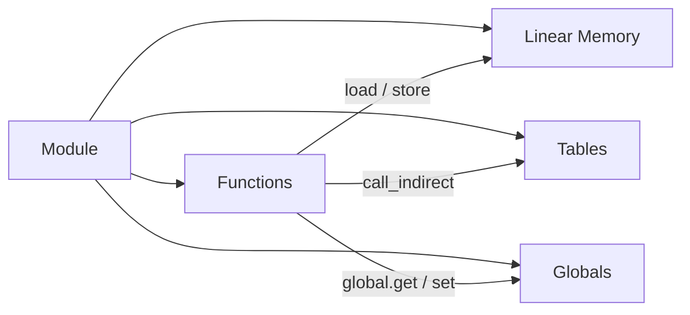
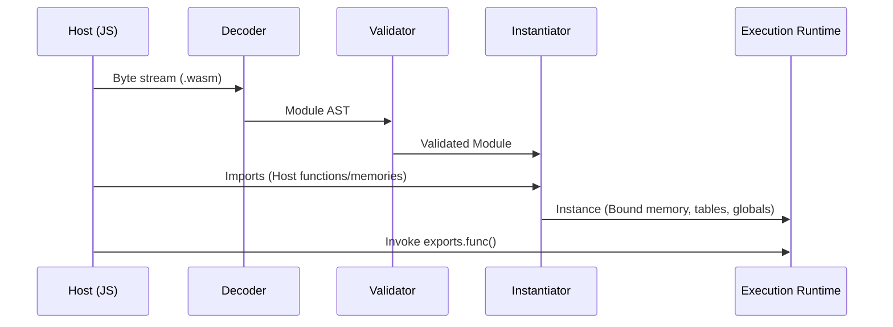

# Chapter 01: Core Architecture of WebAssembly

> **Author:** Wirot Chookeaw ([`chin6700x`](https://github.com/chin6700x)) • **License:** Apache-2.0 / MIT © 2026

[⬅ Chapter 00](00-introduction.md) | [Table of Contents](README.md) | [Chapter 02 ➡](02-binary-format.md)

---

## 1.1 The Stack Machine Architecture

WebAssembly defines execution semantics over a **stack-based virtual machine**: instructions pop their required operands from the operand stack, compute their result, and push that result back onto the stack.

```text
i32.const 2      ; stack: [2]
i32.const 3      ; stack: [2, 3]
i32.add          ; stack: [5]
```

### Stack Machine vs Register Machine Comparison

| Feature | Stack Machine (Wasm) | Register Machine (ARM64, x86_64) |
| :--- | :--- | :--- |
| **Operand Location** | Implicit on the evaluation stack | Explicitly encoded register indices |
| **Code Density** | Ultra-compact (zero register payload bits) | Larger instruction encodings |
| **Validation Complexity** | Linear, single-pass type-state verification | More complex live-range analysis |
| **Native Target JIT** | Engine performs host register allocation | Compiler front-end manages register allocation |

> [!NOTE]
> The WebAssembly operand stack is a purely **logical abstraction** designed for formal validation and portable semantics. High-performance runtimes (V8, JavaScriptCore, Wasmtime) allocate physical hardware registers during JIT/AOT compilation, incurring zero runtime stack penalty.

### Crucial Architectural Invariants

- **The Operand Stack is separate from Linear Memory:** Programs cannot take pointers to values on the operand stack, fundamentally eliminating Return-Oriented Programming (ROP) attacks and stack buffer overflow exploits by design.
- **Dedicated Engine Call Stack:** The runtime execution call stack is managed entirely by the host engine and is completely inaccessible to running Wasm bytecode.
- **Statically Verifiable Stack Depth:** At any point during validation, the exact type and count of elements on the operand stack are known deterministically.

---

## 1.2 The Four Pillars of a Wasm Module



### 1.2.1 Functions

- Every function has a strict **type signature**: parameter types $\rightarrow$ result types, e.g., `(i32, i32) -> i32`.
- Functions declare a set of **local variables** (`locals`), which include their parameters. Parameters are assigned indices starting from 0, followed by subsequent local variables.
- Since Core 2.0, functions can return multiple values (**multi-value** semantics).
- Function signatures reside in the Type Section (Section 1), while function bodies live in the Code Section (Section 10).

### 1.2.2 Linear Memory

- A contiguous, unsegmented array of raw bytes starting at address 0.
- Measured and allocated in **pages = 65,536 bytes** (64 KiB).
- Accessed exclusively through `load` and `store` instructions; every access is bounds-checked by the hardware/runtime. Out-of-bounds access triggers a hardware **trap**.
- Standard Wasm 1.0 supports 1 memory per module (Multi-Memory is specified in Wasm 3.0).
- Exposed to JavaScript as an `ArrayBuffer` via `WebAssembly.Memory`.

### 1.2.3 Tables

- Heterogeneous arrays of opaque **references** (such as `funcref` or `externref`) that disguise raw code pointers.
- Replaces raw function pointers in C: code holds an integer table index and executes it via `call_indirect`, which checks the function type signature dynamically at runtime.
- Because programs cannot inspect real memory addresses of functions, arbitrary indirect branch exploitation is prevented.

### 1.2.4 Globals

- Module-scoped state variables with a declared type and **mutable / immutable** flag.
- Initial values must be evaluated via constant expressions (such as `i32.const 0`).
- Can be imported and exported across modules, commonly used to maintain shared pointers (such as the C stack pointer `__stack_pointer`).

---

## 1.3 The Module Lifecycle: Decode → Validate → Instantiate → Execute



| Lifecycle Phase | Internal Actions | Failure Cause | Resulting JS Error |
| :--- | :--- | :--- | :--- |
| **Decode** | Deserializes raw byte stream into AST structures | Corrupted magic number or malformed sections | `WebAssembly.CompileError` |
| **Validate** | Verifies type safety, indices, and stack invariants | Type mismatch or invalid opcode sequence | `WebAssembly.CompileError` |
| **Instantiate** | Allocates memory, binds imports, runs start function | Missing imports or signature mismatch | `WebAssembly.LinkError` |
| **Execute** | Executes exported functions | Out-of-bounds, divide-by-zero, unreachable | `WebAssembly.RuntimeError` (Trap) |

### Module vs Instance

- **Module** = The stateless, pre-compiled, and validated code artifact. Modules are safe to share across Web Workers and threads via `postMessage()`.
- **Instance** = A Module instantiated with active runtime state (its own dedicated linear memory, tables, and globals). A single module can instantiate multiple isolated instances.

---

## 1.4 Hands-On: A Complete Minimal Module Featuring All 4 Pillars

Below is a self-contained, verified 116-byte WebAssembly binary featuring all four architectural pillars: functions `add`, `inc`, `get`; linear memory (1 page); a table (1 entry); and a mutable global counter:

```javascript
const bytes = new Uint8Array([
  0x00,0x61,0x73,0x6D, 0x01,0x00,0x00,0x00,                     // Wasm Header
  // Type Section: t0 = (i32, i32) -> i32, t1 = () -> i32
  0x01,0x0B,0x02, 0x60,0x02,0x7F,0x7F,0x01,0x7F, 0x60,0x00,0x01,0x7F,
  // Function Section: add:t0, inc:t1, get:t1
  0x03,0x04,0x03, 0x00,0x01,0x01,
  // Table Section: 1 x funcref, min=1
  0x04,0x04,0x01, 0x70,0x00,0x01,
  // Memory Section: min=1 page (64 KiB)
  0x05,0x03,0x01, 0x00,0x01,
  // Global Section: mutable i32 = 0
  0x06,0x06,0x01, 0x7F,0x01, 0x41,0x00,0x0B,
  // Export Section: add, inc, get, mem, tbl
  0x07,0x1F,0x05,
    0x03,0x61,0x64,0x64,0x00,0x00,
    0x03,0x69,0x6E,0x63,0x00,0x01,
    0x03,0x67,0x65,0x74,0x00,0x02,
    0x03,0x6D,0x65,0x6D,0x02,0x00,
    0x03,0x74,0x62,0x6C,0x01,0x00,
  // Element Section: table[0] = func 0 (add)
  0x09,0x07,0x01, 0x00, 0x41,0x00,0x0B, 0x01,0x00,
  // Code Section:
  0x0A,0x1A,0x03,
    0x07,0x00, 0x20,0x00, 0x20,0x01, 0x6A, 0x0B,                  // add: local.get 0, 1; i32.add; end
    0x0B,0x00, 0x23,0x00, 0x41,0x01, 0x6A, 0x24,0x00, 0x23,0x00, 0x0B, // inc: global.get; +1; global.set; get; end
    0x04,0x00, 0x23,0x00, 0x0B                                     // get: global.get 0; end
]);

console.log(WebAssembly.validate(bytes));            // true
const e = new WebAssembly.Instance(new WebAssembly.Module(bytes)).exports;

console.log(e.add(2, 3));                            // 5
console.log(e.inc(), e.inc(), e.get());              // 1 2 2   (Global persists state)
console.log(e.mem.buffer.byteLength);                // 65536   (1 page = 64 KiB)
console.log(e.tbl.length, e.tbl.get(0) === e.add);   // 1 true
```

### Instruction Walkthrough of `inc`:

| Hex Bytes | Wasm Opcode | Resulting Stack State | Explanation |
| :--- | :--- | :--- | :--- |
| `23 00` | `global.get 0` | `[g]` | Push global counter value |
| `41 01` | `i32.const 1` | `[g, 1]` | Push immediate constant 1 |
| `6A` | `i32.add` | `[g + 1]` | Pop operands, push sum |
| `24 00` | `global.set 0` | `[]` | Write incremented value back to global |
| `23 00` | `global.get 0` | `[g + 1]` | Retrieve updated value |
| `0B` | `end` | `[g + 1]` | Return result to caller |

---

## 1.5 Traps: Abnormal Program Termination

A **trap** represents an immediate, uncatchable execution termination generated inside Wasm, which surfaces to JavaScript as a `WebAssembly.RuntimeError`:

| Trap Trigger | Concrete Example |
| :--- | :--- |
| `unreachable` | Direct invocation of the `unreachable` opcode |
| Integer Division by Zero | `i32.div_s` where divisor is `0` |
| Integer Overflow | `i32.div_s` dividing `INT32_MIN (-2147483648)` by `-1` |
| Memory Out-of-Bounds | `i32.load` reading outside allocated linear memory pages |
| Indirect Call Signature Mismatch | Invoking an empty table slot or mismatched function signature |
| Call Stack Exhaustion | Unbounded recursion exceeding the engine's call stack limit |

---

## 1.6 The Security Sandbox Model

1. **Memory Isolation:** Wasm accesses only its assigned Linear Memory slice; host operating system and browser memory remain entirely invisible.
2. **Deterministic Control Flow:** Control flow is strictly structured (no arbitrary `goto`); indirect calls must pass runtime signature verification.
3. **Capability-Based Imports:** Wasm has no implicit system access. It cannot interact with the host system unless the host explicitly injects functions through the import object.
4. **Pre-Execution Validation:** Bytecode must pass 100% formal type verification before a single instruction is allowed to run.

---

## Chapter 01 Summary

- WebAssembly is a statically typed stack machine that enforces strict validation prior to execution.
- Built on four architectural pillars: Functions, Linear Memory (64 KiB pages), Tables (function references), and Globals.
- Module lifecycle spans Decode $\rightarrow$ Validate $\rightarrow$ Instantiate $\rightarrow$ Execute.
- Next Chapter: [Chapter 02: W3C Binary Format & Section Architecture](02-binary-format.md).
