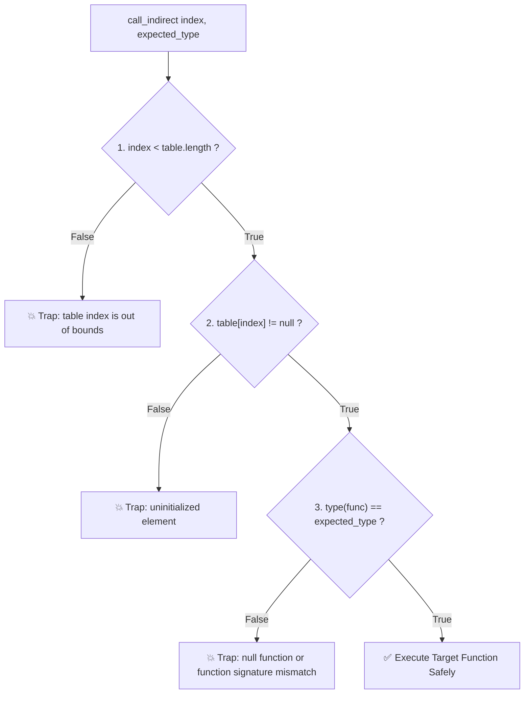

# Chapter 07: Function Pointers and Tables (Tables & Indirect Call Dispatch)

> **Author:** Wirot Chookeaw ([chin6700x](https://github.com/chin6700x)) • **Documentation:** [CC BY-NC-ND 4.0](https://creativecommons.org/licenses/by-nc-nd/4.0/) • **Code:** [Apache-2.0 / MIT](../LICENSE)  
> **References:** [W3C Core Spec — Table Section](https://webassembly.github.io/spec/core/binary/modules.html#table-section) • [W3C Core Spec — Element Section](https://webassembly.github.io/spec/core/binary/modules.html#element-section) • [MDN WebAssembly.Table](https://developer.mozilla.org/en-US/docs/WebAssembly/JavaScript_interface/Table)

[⬅ Chapter 06](06-linear-memory.md) | [Table of Contents](README.md) | [Chapter 08 ➡](08-js-integration.md)

> [!NOTE]
> All binary examples and Table architectural mechanisms in this chapter have been validated against the production V8 Engine in [examples/table-test.js](examples/table-test.js) (covering `call_indirect`, Type Signature Mismatch Traps, Out-of-bounds Table Traps, JS `table.set`/`grow` Hot-swapping, and emulating C++ VTABLE Polymorphism in Linear Memory).

---

## 7.1 The Problem of Function Pointers in a Type-Safe Sandbox

In traditional C and C++, a **Function Pointer** is simply a raw 32-bit or 64-bit unsigned integer holding a direct virtual memory address located in the code segment (`.text` section):

```c
// In conventional C
int (*operation)(int, int) = &add; // Stores actual memory address, e.g., 0x00401520
int result = operation(10, 20);     // CPU executes direct indirect branch (call/jmp rax)
```

Directly adopting this unconstrained pointer paradigm in WebAssembly would create **two catastrophic security vulnerabilities**:

### 1. Violation of Arbitrary Code Execution Defenses (W^X / DEP Invalidation)
WebAssembly enforces a strict **Harvard-like Architecture** that fundamentally segregates data memory (Linear Memory) from code execution (Instruction Stream). Linear Memory contains raw, unprivileged data bytes that are strictly **non-executable**. If arbitrary jumps to numeric addresses inside Linear Memory were permitted, an adversary could write synthetic bytecode into a buffer and branch to it, triggering classic Buffer Overflow or Return-Oriented Programming (ROP) exploits.

### 2. Type Confusion and Stack Frame Corruption
In a typed stack machine, function invocations require absolute guarantees that the types and quantities of operand stack values precisely mirror the target function's parameter signature:
- If a program erroneously casts a function pointer—such as casting a `() -> ()` function into an `(i32, i32) -> i32` signature and executing it:
- The engine's execution stack will desynchronize, corrupting caller frames and shattering sandbox containment.

### The W3C Solution: The WebAssembly Table (`funcref`)
To resolve this securely, the W3C WebAssembly specification introduces an opaque host-managed structure designated as a **Table**:
- A Table is an **opaque array** managed exclusively by the host runtime environment, containing function references (`funcref`).
- WebAssembly bytecode cannot read, write, or slice the raw bytes of Table cells directly as it does with Linear Memory.
- **In WebAssembly, a "function pointer" is never a raw memory address; it is strictly an integer index into an authorized Table (0, 1, 2, ...).**

---

## 7.2 Binary Structure: Table Section (Section 4) & Element Section (Section 9)

Indirect dispatch at the binary level relies on coordinated orchestration between two specialized sections:

```
+------------------------------------+------------------------------------+
|     Section 4: Table Section       |     Section 9: Element Section     |
|   (Declares Table Count & Type)    |  (Populates Function Indexes)      |
|                                    |                                    |
| Table 0: Type = funcref, Min = 4   | Table 0 [Offset 0] = [fn0, fn1,...]|
+------------------------------------+------------------------------------+
```

### 1. Section 4: Table Section (ID `0x04`)
Declares tables within the module, defining reference types (`reftype`) and sizing limits (`limits`):

```
[0x04] [section_size: u32] [table_count: u32] [table_0_type] ...
```

The `table_type` descriptor contains:
- **Element Reference Type (`reftype`):**
  - `0x70` = **`funcref`** (Reference to a typed WebAssembly function)
  - `0x6F` = **`externref`** (Reference to an opaque external host object, such as a JavaScript object or DOM Node)
- **Limits:**
  - `0x00 [min: u32]` $\rightarrow$ Minimum initial capacity with no upper bound
  - `0x01 [min: u32] [max: u32]` $\rightarrow$ Explicit minimum initial and maximum allowable capacity

**Binary Bytecode Example:**  
`0x04 0x05 0x01 0x70 0x01 0x04 0x08` $\rightarrow$ Table Section declaring 1 table of type `funcref`, min capacity 4 entries, max capacity 8 entries.

---

### 2. Section 9: Element Section (ID `0x09`)
Functions analogously to the Data Section for Linear Memory, serving to **initialize (populate) specific Table slots** with function references upon module instantiation:

Active Element Segment format (WebAssembly 1.0 baseline):
```
[segment_mode: 0x00] [offset_expr] [func_count: u32] [func_idx_0] [func_idx_1] ...
```
- `0x00`: Active segment targeting Table Index 0
- `offset_expr`: Constant initialization expression specifying starting table slot, e.g., `i32.const 0, end` (`0x41 0x00 0x0B`)
- `func_count`: Total number of function indices to write
- `func_idx_*`: Target Function Index references declared in the Function Section

---

## 7.3 Indirect Invocation: The `call_indirect` Opcode (`0x11`)

When dispatching through a table-based pointer, WebAssembly executes the **`call_indirect`** instruction:

$$\mathbf{\text{Opcode: } 0x11} \quad [\text{typeidx: u32 LEB128}] \quad [\text{tableidx: u32 LEB128}]$$

> In WebAssembly 1.0, `tableidx` is reserved and hardcoded to `0x00` (the default primary table).

### Operand Stack Layout:
All positional arguments must be pushed onto the operand stack first, with the **Table dynamic slot index residing at the very top of the stack**:

```
Stack Pre-Call:   [ arg_1, arg_2, ..., arg_N, dynamic_table_index ]
Instruction:      call_indirect $expected_type $table_idx
Stack Post-Call:  [ result_1, ... ]
```

### Three-Stage Runtime Validation Trapping Guards:
Whenever `call_indirect` executes, the host runtime evaluates three invariant hardware/software validation guards in strict sequence:



1. **Table Bounds Guard:**  
   If the runtime index exceeds `table.length` $\rightarrow$ Immediate trap: `RuntimeError: table index is out of bounds`.
2. **Null / Uninitialized Guard:**  
   If the slot holds no populated function reference (`null`) $\rightarrow$ Immediate trap: `RuntimeError: uninitialized element`.
3. **Type Signature Guard:**  
   If the target function's type signature fails to match `typeidx` byte-for-byte $\rightarrow$ Immediate trap: `RuntimeError: null function or function signature mismatch`.

---

## 7.4 Emulating C++ Virtual Method Tables (VTABLE) in WebAssembly

When compiling polymorphic object-oriented languages (such as C++ virtual classes or Rust trait objects) to WebAssembly, the compiler synthesizes dynamic dispatch by uniting **Linear Memory** with **Tables**:

### 1. Object Memory Layout in Linear Memory:
Each class instance in Linear Memory reserves its first 4 bytes (Offset +0) for the **`vptr` (Virtual Table Pointer)**, storing the **Table Index**:

```
Rectangle Object (Address 100):
+--------------------+--------------------+--------------------+
| Offset +0: vtable  | Offset +4: width   | Offset +8: height  |
| Value: 0 (rect)    | Value: 25          | Value: 10          |
+--------------------+--------------------+--------------------+

Triangle Object (Address 200):
+--------------------+--------------------+--------------------+
| Offset +0: vtable  | Offset +4: width   | Offset +8: height  |
| Value: 1 (tri)     | Value: 30          | Value: 8           |
+--------------------+--------------------+--------------------+
```

### 2. Virtual Function Table (WebAssembly Table):
```
Table[0] = rect_area(this_ptr: i32) -> i32
Table[1] = tri_area(this_ptr: i32)  -> i32
```

### 3. WAT Dispatcher Implementation (`shape_area`):
```wat
(func $shape_area (export "shape_area") (param $this_ptr i32) (result i32)
  ;; 1. Pass 'this' pointer as the first argument
  local.get $this_ptr

  ;; 2. Load the vtable index stored at memory [this_ptr + 0]
  local.get $this_ptr
  i32.load offset=0 align=2

  ;; 3. Indirectly dispatch through Table 0 using expected type signature
  call_indirect (type $shape_method_type)
)
```

Execution trace for `shape_area(100)`:
- Reads `vtable_idx = 0` $\rightarrow$ calls `rect_area(100)` $\rightarrow$ yields $25 \times 10 = \mathbf{250}$.  
Execution trace for `shape_area(200)`:
- Reads `vtable_idx = 1` $\rightarrow$ calls `tri_area(200)` $\rightarrow$ yields $\frac{30 \times 8}{2} = \mathbf{120}$.

This represents the exact mechanism employed by modern production compilers (Clang/LLVM and sovereign emitters) to achieve high-performance zero-overhead polymorphism on WebAssembly.

---

## 7.5 Managing Tables via JavaScript (`WebAssembly.Table` API)

JavaScript hosts can inspect, manipulate, and dynamically rebind WebAssembly Table objects at runtime:

```javascript
const instance = await WebAssembly.instantiate(wasmBytes);
const table = instance.exports.table;

// 1. Inspect table capacity
console.log(table.length); // e.g., 4 slots

// 2. Extract function reference and invoke directly from JavaScript
const fn = table.get(0);
console.log(fn(10, 20)); // Dispatches directly into Wasm function

// 3. Runtime function hot-swapping (repoint table slot)
table.set(1, table.get(0)); // Replaces slot 1 with function at slot 0

// 4. Dynamic table expansion (grow table capacity)
const oldLength = table.grow(2); // Request 2 additional slots
console.log(`Previous: ${oldLength}, Current: ${table.length}`);
```

---

## 7.6 Modern WebAssembly 2.0 Table Instructions

WebAssembly 2.0 introduces direct bytecode instructions for table inspection and manipulation without requiring JavaScript host call transitions:

| Opcode Prefix | Opcode | Instruction | Stack Pre $\rightarrow$ Post | Operational Semantics |
| :---: | :---: | :--- | :--- | :--- |
| - | `0x25` | `table.get x` | `[i32] -> [funcref]` | Reads reference at index `i` from table `x` |
| - | `0x26` | `table.set x` | `[i32 funcref] -> []` | Writes reference to index `i` in table `x` |
| `0xFC` | `0x10` | `table.size x` | `[] -> [i32]` | Returns current allocated length of table `x` |
| `0xFC` | `0x0F` | `table.grow x` | `[funcref i32] -> [i32]` | Grows table `x` by delta slots; returns old size |
| `0xFC` | `0x11` | `table.fill x` | `[i32 funcref i32] -> []` | Fills slot range with given reference |
| `0xFC` | `0x0E` | `table.copy x y` | `[i32 i32 i32] -> []` | Copies table slice from table `y` to table `x` |

To examine the live test suite validating these table semantics and runtime trap assertions under the V8 engine, inspect [examples/table-test.js](examples/table-test.js).

---

[⬅ Chapter 06: Linear Memory Model](06-linear-memory.md) | [Main Table of Contents](README.md) | [Chapter 08: JavaScript Integration & Browser APIs ➡](08-js-integration.md)
