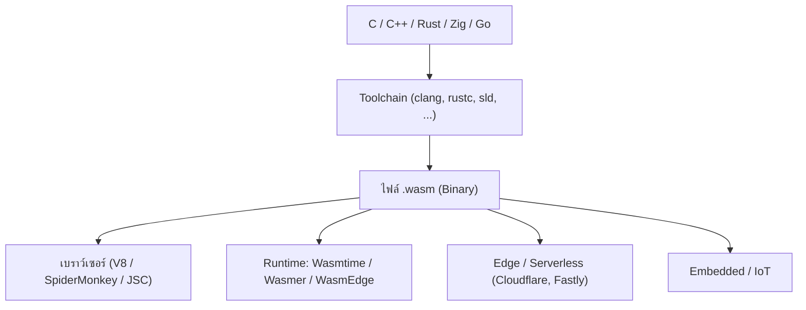

# บทนำ: ปรัชญาและรากฐานของ WebAssembly

> ผู้เขียน: Wirot Chookeaw (`chin6700x`) • เอกสาร: [CC BY-NC-ND 4.0](https://creativecommons.org/licenses/by-nc-nd/4.0/) • โค้ด: [Apache-2.0 / MIT](../LICENSE)
> อ้างอิง: [webassembly.org](https://webassembly.org/) • [MDN WebAssembly](https://developer.mozilla.org/en-US/docs/WebAssembly)

[⬅ กลับสารบัญ](README.md) | [บทที่ 1 ➡](01-core-architecture.md)

---

## 0.1 ทำไมต้อง WebAssembly?

JavaScript ถูกออกแบบมาเป็นภาษา scripting แบบ dynamic ซึ่งยืดหยุ่นมาก แต่มีข้อจำกัดเมื่อต้องทำงานหนัก:

| ปัญหา | อธิบาย |
| :--- | :--- |
| **Dynamic typing** | engine ต้องเดาชนิดข้อมูลขณะรัน (JIT speculation) และอาจ "deoptimize" เมื่อเดาผิด ทำให้ประสิทธิภาพไม่คงที่ |
| **Garbage collection** | GC pause ทำให้เฟรมเรตกระตุกในเกมหรืองานเรียลไทม์ |
| **ตัวเลขชนิดเดียว** | `Number` เป็น float64 เสมอ ไม่มี int32/int64 จริง (ยกเว้น `BigInt` ที่ช้ากว่า) |
| **เวลาเริ่มต้น (warm-up)** | ต้อง parse → compile → optimize ซอร์สข้อความ ทุกครั้งที่โหลด |
| **ภาษาอื่นใช้ไม่ได้** | โค้ด C/C++/Rust ที่มีอยู่แล้วหลายล้านบรรทัด นำมารันบนเว็บไม่ได้ |

WebAssembly (ย่อ **Wasm**) แก้ปัญหาเหล่านี้โดยเป็น **binary instruction format** ที่:

- มีชนิดข้อมูลแบบ static (`i32`, `i64`, `f32`, `f64`) จึง compile เป็นเครื่องจริงได้ตรงไปตรงมา
- ไม่มี GC ในแกนหลัก (Core 1.0/2.0) ผู้เขียนควบคุมหน่วยความจำเอง
- เป็นไบนารีกะทัดรัด decode เร็วกว่า parse ข้อความ JavaScript มาก
- เป็นเป้าหมายการคอมไพล์ (compile target) ของภาษาอื่น เช่น C, C++, Rust, Zig, Go

> [!NOTE]
> Wasm **ไม่ได้มาแทนที่** JavaScript แต่ทำงานคู่กัน: JS ดูแล UI/DOM/การเชื่อมต่อ ส่วน Wasm ดูแลงานคำนวณหนัก

---

## 0.2 มาตรฐานเปิด W3C และเป้าหมาย 4 ประการ

WebAssembly เป็นมาตรฐานของ **W3C** (ได้เป็น W3C Recommendation ตั้งแต่ธันวาคม 2019) ร่วมพัฒนาโดยผู้ผลิตเบราว์เซอร์หลักทั้งหมด (Mozilla, Google, Apple, Microsoft)

เป้าหมายหลักตามที่ระบุใน [webassembly.org](https://webassembly.org/):

1. **Fast (เร็ว)** — ทำงานใกล้เคียงความเร็วเนทีฟ โดยใช้ความสามารถของฮาร์ดแวร์ทั่วไป
2. **Safe (ปลอดภัย)** — รันใน sandbox, หน่วยความจำของ Wasm แยกจากโฮสต์, ต้องผ่าน **validation** ก่อนรันเสมอ
3. **Portable (พกพาได้)** — ไบนารีเดียวกันรันได้ทุกแพลตฟอร์ม/สถาปัตยกรรม (x86, ARM, RISC-V)
4. **Compact (กะทัดรัด)** — รูปแบบไบนารีเล็ก โหลดผ่านเครือข่ายเร็ว และ decode แบบ streaming ได้

### สเปกที่ควรรู้จัก

| เอกสาร | เนื้อหา |
| :--- | :--- |
| **Core Specification** | โครงสร้างไบนารี, ชุดคำสั่ง, กฎ validation, ความหมายการรัน (semantics) |
| **JavaScript Interface** | `WebAssembly.*` API ฝั่ง JS |
| **Web API Interface** | `instantiateStreaming`, การโหลดผ่าน `fetch` |
| **WASI** | System interface สำหรับรันนอกเบราว์เซอร์ |

สเปกหลัก: https://webassembly.github.io/spec/core/

---

## 0.3 ระบบนิเวศของ Wasm



- **เบราว์เซอร์**: โหลดผ่าน JavaScript API (`WebAssembly.instantiate*`)
- **นอกเบราว์เซอร์**: ใช้ **WASI** เป็นตัวกลางเรียกระบบปฏิบัติการ (ไฟล์, เวลา, สุ่ม) แบบ capability-based
- **Serverless/Edge**: cold start เร็วระดับไมโครวินาที เพราะ sandbox เบากว่า container

---

## 0.4 เส้นทางการสร้าง Wasm (ภาพรวมที่คู่มือนี้จะสอน)

| เส้นทาง | เครื่องมือ | ข้อดี | ข้อเสีย |
| :--- | :--- | :--- | :--- |
| **A. Emscripten** | `emcc` | มี libc ครบ, glue JS พร้อม | หนัก, ช้า, ไฟล์ใหญ่ |
| **B. Clang ตรง** | `clang --target=wasm32` + `wasm-ld` | เบา, ควบคุมได้ | ไม่มี libc ต้องจัดการเอง |
| **C. เขียน emitter เอง** | ตัวอย่าง: `sld --target=wasm32` | เข้าใจลึกที่สุด, เร็วมาก | ต้องทำ feature เอง |
| **D. เขียนมือด้วย WAT** | `wat2wasm` | เรียนรู้โครงสร้างได้ชัด | ไม่เหมาะงานใหญ่ |

บทที่ 1–8 อธิบายสเปกที่ **ทุกเส้นทางต้องปฏิบัติตาม** ส่วนบทที่ 9–10 ลงลึกเส้นทาง B และ C

---

## 0.5 Hello Wasm: ไบนารีที่เล็กที่สุดที่ถูกต้อง

โมดูลว่างที่ถูกต้องตามสเปกมีเพียง **8 ไบต์**:

```text
00 61 73 6D   01 00 00 00
\0  a  s  m   version = 1
```

ทดสอบใน Node.js:

```javascript
const bytes = new Uint8Array([0x00,0x61,0x73,0x6D, 0x01,0x00,0x00,0x00]);
console.log(WebAssembly.validate(bytes)); // true
const mod = await WebAssembly.instantiate(bytes);
console.log(mod.instance.exports);        // {}
```

ตัวอย่างฟังก์ชัน `add(i32, i32) -> i32` (ไบนารีสมบูรณ์ 41 ไบต์):

```javascript
const add = new Uint8Array([
  0x00,0x61,0x73,0x6D, 0x01,0x00,0x00,0x00,      // header
  0x01,0x07,0x01,0x60,0x02,0x7F,0x7F,0x01,0x7F,  // type: (i32,i32)->i32
  0x03,0x02,0x01,0x00,                            // function: 1 func, type 0
  0x07,0x07,0x01,0x03,0x61,0x64,0x64,0x00,0x00,  // export "add" = func 0
  0x0A,0x09,0x01,0x07,0x00,                       // code: 1 body, size 7, 0 locals
  0x20,0x00, 0x20,0x01, 0x6A, 0x0B                // local.get 0; local.get 1; i32.add; end
]);
const { instance } = await WebAssembly.instantiate(add);
console.log(instance.exports.add(2, 3)); // 5
```

> [!IMPORTANT]
> นี่คือแก่นของ Wasm: ไฟล์ `.wasm` เป็นเพียงไบต์ที่จัดตามกฎ ไม่จำเป็นต้องมีคอมไพเลอร์ขนาดใหญ่ ขอเพียงเขียนไบต์ให้ถูกต้องตามสเปกและผ่าน validation

---

## สรุปบทที่ 0

- Wasm คือ binary format แบบ static-typed บน stack machine ที่เร็ว ปลอดภัย พกพาได้ และกะทัดรัด
- เป็นมาตรฐาน W3C ใช้ได้ทั้งในและนอกเบราว์เซอร์
- ไฟล์ Wasm ที่เล็กที่สุดคือ 8 ไบต์ และเขียนด้วยมือได้
- บทถัดไป: [สถาปัตยกรรมแกนกลาง](01-core-architecture.md)
