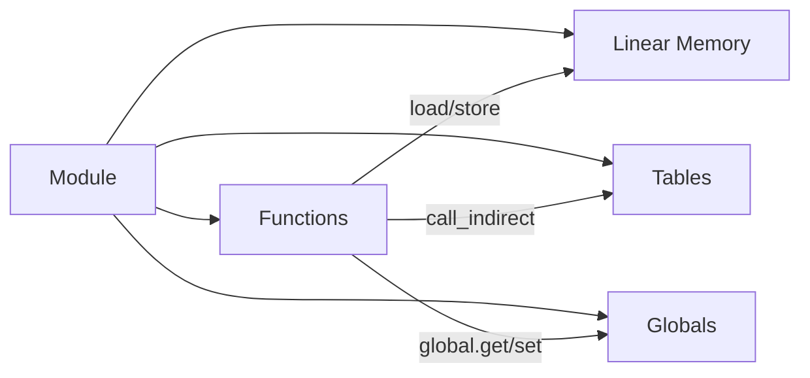
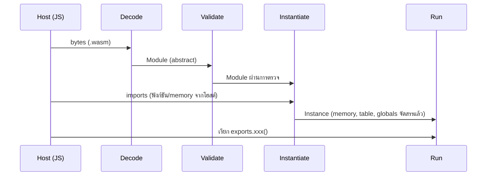

# บทที่ 1: สถาปัตยกรรมแกนกลางของ WebAssembly

> ผู้เขียน: Wirot Chookeaw (`chin6700x`) • เอกสาร: [CC BY-NC-ND 4.0](https://creativecommons.org/licenses/by-nc-nd/4.0/) • โค้ด: [Apache-2.0 / MIT](../LICENSE)
[⬅ บทที่ 0](00-introduction.md) | [สารบัญ](README.md) | [บทที่ 2 ➡](02-binary-format.md)

---

## 1.1 เครื่องจักรแบบสแตก (Stack Machine)

WebAssembly นิยามการทำงานบน **stack-based virtual machine**: คำสั่งแต่ละตัว pop ตัวถูกดำเนินการจากสแตก แล้ว push ผลลัพธ์กลับ

```text
i32.const 2      ; stack: [2]
i32.const 3      ; stack: [2, 3]
i32.add          ; stack: [5]
```

### เปรียบเทียบกับ Register Machine

| หัวข้อ | Stack machine (Wasm) | Register machine (ARM64, x86) |
| :--- | :--- | :--- |
| ตัวถูกดำเนินการ | อยู่บนสแตกโดยปริยาย | ระบุ register ในคำสั่ง |
| ขนาดโค้ด | เล็ก (ไม่ต้องเข้ารหัส register) | ใหญ่กว่า |
| Validation | ตรวจชนิดสแตกได้ง่าย single-pass | ซับซ้อนกว่า |
| การ compile เป็นเครื่องจริง | engine ทำ register allocation เอง | compiler ต้องทำล่วงหน้า |

> [!NOTE]
> "สแตก" ของ Wasm เป็นแนวคิดเชิง **ตรรกะ** (operand stack) สำหรับ validation และ semantics เท่านั้น engine จริงจะแปลงเป็น register ตอน JIT/AOT จึงไม่ช้าเพราะใช้สแตก

### คุณสมบัติสำคัญ

- **Operand stack ไม่ใช่ส่วนหนึ่งของ Linear Memory** โปรแกรมไม่สามารถเอา address ของสแตกได้ จึงป้องกันการเจาะ return address (ROP) ได้โดยโครงสร้าง
- **Call stack แยกต่างหาก** ที่ engine ดูแล โปรแกรมเข้าถึงไม่ได้
- **ความลึกของสแตกต้องตรวจสอบได้ตอน validate** ทุกจุดของโค้ด รู้ชนิดและจำนวนค่าบนสแตกแน่นอน

---

## 1.2 โครงสร้างโมดูล 4 เสาหลัก



### 1.2.1 Functions

- ทุกฟังก์ชันมี **ลายเซ็น (type)** = ชนิดพารามิเตอร์ → ชนิดผลลัพธ์ เช่น `(i32, i32) -> i32`
- มี **locals** (ตัวแปรเฉพาะที่) ซึ่งรวมพารามิเตอร์ด้วย โดยพารามิเตอร์ได้ index เริ่มจาก 0 และ locals ที่ประกาศเพิ่มต่อจากนั้น
- ตั้งแต่ Core 2.0 ฟังก์ชันคืนค่าได้หลายค่า (multi-value)
- ชนิดของฟังก์ชันอยู่ใน Type Section ส่วนตัวโค้ดอยู่ใน Code Section (บทที่ 2)

### 1.2.2 Linear Memory

- อาร์เรย์ไบต์ที่ต่อเนื่องและขยายได้ เริ่มที่ address 0
- ขนาดวัดเป็น **page = 65,536 ไบต์** (64 KiB)
- เข้าถึงด้วย `load`/`store` เท่านั้น และทุกครั้งมีการตรวจขอบเขต (bounds check) ถ้าเกินจะเกิด **trap**
- Wasm 1.0 มีได้ 1 memory ต่อโมดูล (multi-memory เป็น proposal ใน 3.0)
- JavaScript มองเห็นเป็น `ArrayBuffer` ผ่าน `WebAssembly.Memory`

### 1.2.3 Tables

- อาร์เรย์ของ **reference** (เช่น `funcref`) ที่ซ่อน pointer จริงไว้
- ใช้แทน function pointer ใน C: โค้ดถือเพียง index แล้วเรียกด้วย `call_indirect` ซึ่งเช็คชนิดฟังก์ชันตอนรัน
- เพราะโปรแกรมไม่เห็น address โค้ดจริง จึงกระโดดไปที่อื่นนอกตารางไม่ได้

### 1.2.4 Globals

- ตัวแปรระดับโมดูล มีชนิดและสถานะ **mutable / immutable**
- ค่าเริ่มต้นต้องเป็น constant expression (เช่น `i32.const 0`)
- ส่งออก/นำเข้าข้ามโมดูลได้ จึงใช้แชร์ค่า เช่น stack pointer ของ C

---

## 1.3 วงจรชีวิต: Module → Instantiate → Instance → Execute



| ขั้น | สิ่งที่เกิดขึ้น | ล้มเหลวเมื่อ | JS Error |
| :--- | :--- | :--- | :--- |
| **Decode** | แปลงไบต์เป็นโครงสร้างโมดูล | magic/section ผิดรูป | `CompileError` |
| **Validate** | ตรวจชนิด, index, สแตก | ชนิดไม่ตรง, index เกิน | `CompileError` |
| **Instantiate** | จัดสรร memory/table/global, ผูก imports, รัน start function | import หาย/ชนิดไม่ตรง | `LinkError` |
| **Execute** | เรียกฟังก์ชันที่ export | bounds/divide-by-zero/unreachable | `RuntimeError` (trap) |

### Module vs Instance

- **Module** = โค้ดที่ผ่าน validate แล้ว ไม่มีสถานะ แชร์/คอมไพล์ซ้ำได้ (ส่งผ่าน `postMessage` ไปยัง Worker ได้)
- **Instance** = Module + สถานะรันไทม์ (memory, table, globals ที่จัดสรรแล้ว) จาก Module เดียวสร้างได้หลาย Instance

---

## 1.4 ตัวอย่างลงมือจริง: โมดูลที่มีครบ 4 เสาหลัก

โมดูลนี้มี: function `add`, `inc`, `get` • memory 1 page • table 1 ช่อง • global mutable (counter) เขียนด้วยไบต์ล้วน และผ่านการทดสอบแล้ว (116 ไบต์)

```javascript
const bytes = new Uint8Array([
  0,0x61,0x73,0x6d, 1,0,0,0,                                   // header
  // Type: t0=(i32,i32)->i32, t1=()->i32
  0x01,0x0b,0x02, 0x60,0x02,0x7f,0x7f,0x01,0x7f, 0x60,0x00,0x01,0x7f,
  // Function: add:t0, inc:t1, get:t1
  0x03,0x04,0x03, 0x00,0x01,0x01,
  // Table: 1 x funcref, min=1
  0x04,0x04,0x01, 0x70,0x00,0x01,
  // Memory: min=1 page
  0x05,0x03,0x01, 0x00,0x01,
  // Global: mutable i32 = 0
  0x06,0x06,0x01, 0x7f,0x01, 0x41,0x00,0x0b,
  // Export: add, inc, get, mem, tbl
  0x07,0x1f,0x05,
    0x03,0x61,0x64,0x64,0x00,0x00,
    0x03,0x69,0x6e,0x63,0x00,0x01,
    0x03,0x67,0x65,0x74,0x00,0x02,
    0x03,0x6d,0x65,0x6d,0x02,0x00,
    0x03,0x74,0x62,0x6c,0x01,0x00,
  // Element: table[0] = func 0 (add)
  0x09,0x07,0x01, 0x00, 0x41,0x00,0x0b, 0x01,0x00,
  // Code
  0x0a,0x1a,0x03,
    0x07,0x00, 0x20,0x00, 0x20,0x01, 0x6a, 0x0b,                  // add
    0x0b,0x00, 0x23,0x00, 0x41,0x01, 0x6a, 0x24,0x00, 0x23,0x00, 0x0b, // inc
    0x04,0x00, 0x23,0x00, 0x0b                                     // get
]);

console.log(WebAssembly.validate(bytes));            // true
const e = new WebAssembly.Instance(new WebAssembly.Module(bytes)).exports;

console.log(e.add(2, 3));                            // 5
console.log(e.inc(), e.inc(), e.get());              // 1 2 2   (global เก็บสถานะ)
console.log(e.mem.buffer.byteLength);                // 65536   (1 page)
console.log(e.tbl.length, e.tbl.get(0) === e.add);   // 1 true
```

### อ่านโค้ดเครื่อง `inc` ทีละคำสั่ง

| ไบต์ | คำสั่ง | สแตกหลังทำงาน |
| :--- | :--- | :--- |
| `23 00` | `global.get 0` | `[g]` |
| `41 01` | `i32.const 1` | `[g, 1]` |
| `6a` | `i32.add` | `[g+1]` |
| `24 00` | `global.set 0` | `[]` (เขียนกลับ global) |
| `23 00` | `global.get 0` | `[g+1]` |
| `0b` | `end` | คืนค่า `g+1` |

---

## 1.5 Trap: เมื่อโปรแกรมทำผิดกติกา

Trap คือการหยุดทำงานทันที ไม่สามารถ catch ภายใน Wasm ได้ ส่งผลเป็น `WebAssembly.RuntimeError` ใน JS:

| สาเหตุ | ตัวอย่าง |
| :--- | :--- |
| `unreachable` | ถูกเรียกโดยตรง |
| หารด้วยศูนย์ | `i32.div_s` เมื่อตัวหาร = 0 |
| จำนวนเต็มล้น | `i32.div_s` เมื่อ INT_MIN / -1 |
| Memory out of bounds | `i32.load` เกินขนาด memory |
| `call_indirect` ผิด | ช่องว่าง/ชนิดไม่ตรง |
| Stack overflow | เรียกซ้ำลึกเกินขีดจำกัดของ engine |

```javascript
try { e.tbl.get(5); } catch (err) { console.log(err.name); } // RangeError (นอกขอบเขต table จากฝั่ง JS)
```

---

## 1.6 โมเดลความปลอดภัย (Sandbox)

1. **Memory isolation** — Wasm เห็นเฉพาะ Linear Memory ของตัวเอง ไม่เห็นหน่วยความจำของเบราว์เซอร์
2. **No arbitrary jumps** — control flow แบบมีโครงสร้าง (บทที่ 5) และ call ทางอ้อมผ่าน table ที่เช็คชนิด
3. **Capability by import** — Wasm ทำอะไรกับโลกภายนอกไม่ได้เลย เว้นแต่โฮสต์ส่งฟังก์ชันให้ผ่าน imports
4. **Validate before run** — ไบนารีที่ผิดกฎถูกปฏิเสธก่อนรันแม้แต่คำสั่งเดียว

> [!WARNING]
> Sandbox ป้องกันโค้ดหลุดออกนอกกรอบ แต่ **ไม่ได้ป้องกันบั๊กภายใน** Linear Memory เช่น buffer overflow ในโค้ด C ที่คอมไพล์เป็น Wasm ยังทำให้ข้อมูลของตัวเองเสียหายได้

---

## สรุปบทที่ 1

- Wasm เป็น stack machine แบบ static-typed ผ่าน validation ก่อนรันเสมอ
- 4 เสาหลัก: Functions, Linear Memory (page 64 KiB), Tables (reference), Globals
- วงจรชีวิต: Decode → Validate → Instantiate → Execute และ Module แยกจาก Instance
- Trap คือข้อผิดพลาดร้ายแรงที่หยุดโปรแกรมทันที
- บทถัดไป: [โครงสร้าง Binary Format](02-binary-format.md)
