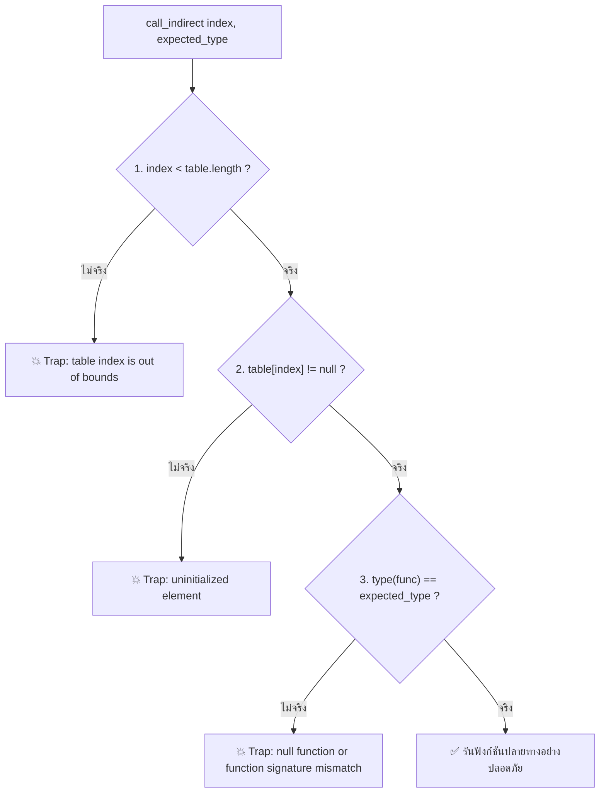

# บทที่ 7: ฟังก์ชันพอยน์เตอร์และตารางทางอ้อม (Tables & Indirect Call Dispatch)

> ผู้เขียน: Wirot Chookeaw (`chin6700x`) • เอกสาร: [CC BY-NC-ND 4.0](https://creativecommons.org/licenses/by-nc-nd/4.0/) • โค้ด: [Apache-2.0 / MIT](../LICENSE)
> อ้างอิง: [W3C Core Spec — Table Section](https://webassembly.github.io/spec/core/binary/modules.html#table-section) • [W3C Core Spec — Element Section](https://webassembly.github.io/spec/core/binary/modules.html#element-section) • [MDN WebAssembly.Table](https://developer.mozilla.org/en-US/docs/WebAssembly/JavaScript_interface/Table)

[⬅ บทที่ 6](06-linear-memory.md) | [สารบัญ](README.md) | [บทที่ 8 ➡](08-js-integration.md)

> [!NOTE]
> ตัวอย่างโค้ดไบนารีและสถาปัตยกรรม Table ทั้งหมดในบทนี้ ได้รับการทดสอบผ่าน V8 Engine จริงใน [examples/table-test.js](examples/table-test.js) (ครอบคลุม `call_indirect`, Type Signature Mismatch Trap, Out-of-bounds Table Trap, JS `table.set`/`grow` Hot-swapping, และการจำลองระบบ C++ VTABLE Polymorphism ใน Linear Memory)

---

## 7.1 ปัญหาของ Function Pointer ในระบบ Type-Safe Sandbox

ในภาษา C และ C++ ดั้งเดิม **Function Pointer** เป็นเพียงค่าจำนวนเต็ม 32-บิต หรือ 64-บิต ธรรมดา ที่ชี้ไปยัง Memory Address ตรงๆ ในโค้ดเซกเมนต์ (`.text` section):

```c
// ในภาษา C ปกติ
int (*operation)(int, int) = &add; // เก็บ Memory Address จริง เช่น 0x00401520
int result = operation(10, 20);     // ซีพียูสั่ง call/jmp ไปยังแอดเดรสนั้นโดยตรง
```

หากนำแนวคิดนี้มาใช้กับ WebAssembly จะก่อให้เกิด **ปัญหาช่องโหว่ความปลอดภัยร้ายแรง 2 ประการ**:

### 1. การทำลายระบบป้องกัน Arbitrary Code Execution (W^X Violation)
WebAssembly ใช้สถาปัตยกรรมแบบ **Harvard-like Architecture** ซึ่งแยกหน่วยความจำข้อมูล (Linear Memory) ออกจากโค้ดสั่งการ (Instruction Stream) อย่างสิ้นเชิง Linear Memory บรรจุได้เฉพาะข้อมูลดิบที่ **ไม่สามารถรันเป็นโค้ดได้ (Non-executable)** หากยอมให้โปรแกรมกระโดดไปยังแอดเดรสใดๆ ภายใน Memory ได้ แฮกเกอร์จะสามารถเขียนไบต์โค้ดปลอมลงใน Heap แล้วกระโดดไปรัน เพื่อโจมตีแบบ Buffer Overflow หรือ Return-Oriented Programming (ROP) ได้ทันที

### 2. ปัญหา Type Confusion (สแตกพังทลาย)
ในระบบ Stack Machine การเรียกฟังก์ชันต้องรับรองว่าจำนวนและชนิดของค่าบนสแตกสอดคล้องกับพารามิเตอร์ของฟังก์ชันปลายทาง 100%:
- หากโปรแกรมแคสต์ Function Pointer แบบผิดพลาด เช่น เอาฟังก์ชัน `() -> ()` ไปเรียกด้วยลายเซ็น `(i32, i32) -> i32`
- สแตกของโฮสต์เอนจินจะพังทลาย (Stack Corruption) ส่งผลให้ระบบ Sandbox เสียหาย

### ทางออกของ W3C: โครงสร้าง WebAssembly Table (`funcref`)
มาตรฐาน W3C จึงออกแบบอ็อบเจกต์ชนิดใหม่เรียกว่า **Table**:
- Table เป็น **Opaque Array** (อาร์เรย์ที่จัดการโดยรันไทม์ของโฮสต์) เก็บการอ้างอิงถึงฟังก์ชัน (References) 
- โค้ด WebAssembly ไม่สามารถอ่านเขียนไบต์ของ Table ได้โดยตรงเหมือน Linear Memory
- **Function Pointer ใน WebAssembly จึงไม่ใช่ Memory Address แต่เป็นเพียง "Table Index (0, 1, 2, ...)"**

---

## 7.2 โครงสร้าง Table Section (Section 4) และ Element Section (Section 9)

การทำงานของระบบฟังก์ชันพอยน์เตอร์ในระดับไบนารี เกิดจากการประสานงานระหว่าง 2 Section:

```
+------------------------------------+------------------------------------+
|     Section 4: Table Section       |     Section 9: Element Section     |
|   (ประกาศขนาดและประเภทของตาราง)      |    (บรรจุ Function Index ลงในตาราง)  |
|                                    |                                    |
| Table 0: Type = funcref, Min = 4   | Table 0 [Offset 0] = [fn0, fn1,...]|
+------------------------------------+------------------------------------+
```

### 1. Section 4: Table Section (ID `0x04`)
ทำหน้าที่ประกาศตาราง โดยระบุประเภทของสมาชิก (`reftype`) และขอบเขตขนาด (`limits`):

```
[0x04] [section_size: u32] [table_count: u32] [table_0_type] ...
```

โครงสร้างของ `table_type`:
- **Element Type (`reftype`):**
  - `0x70` = **`funcref`** (การอ้างอิงถึงฟังก์ชันภายใน Wasm Module)
  - `0x6F` = **`externref`** (การอ้างอิงถึงโฮสต์อ็อบเจกต์ภายนอก เช่น JS Object, DOM Node)
- **Limits:**
  - `0x00 [min: u32]` $\rightarrow$ มีเฉพาะขนาดเริ่มต้น ไม่มีเพดานสูงสุด
  - `0x01 [min: u32] [max: u32]` $\rightarrow$ กำหนดทั้งขนาดเริ่มต้นและเพดานสูงสุด

**ตัวอย่างไบนารี:**  
`0x04 0x05 0x01 0x70 0x01 0x04 0x08` $\rightarrow$ Table Section มี 1 ตาราง, ชนิด `funcref`, ขั้นต่ำ 4 ช่อง, สูงสุด 8 ช่อง

---

### 2. Section 9: Element Section (ID `0x09`)
ทำหน้าที่เหมือน Data Section ของ Linear Memory แต่ใช้สำหรับ **กำหนดค่าเริ่มต้น (Populate) ให้กับช่องต่างๆ ใน Table** เมื่อโมดูลถูกโหลดขึ้นมา:

โครงสร้าง Active Element Segment (แบบ Wasm 1.0 พื้นฐาน):
```
[segment_mode: 0x00] [offset_expr] [func_count: u32] [func_idx_0] [func_idx_1] ...
```
- `0x00`: Active Segment สำหรับ Table Index 0
- `offset_expr`: นิพจน์ค่าคงที่สำหรับระบุตำแหน่งเริ่มต้น เช่น `i32.const 0, end` (`0x41 0x00 0x0B`)
- `func_count`: จำนวนฟังก์ชัน
- `func_idx_*`: หมายเลข Index ของฟังก์ชันใน Function Section ที่ต้องการนำมาใส่

---

## 7.3 การเรียกฟังก์ชันผ่าน Index: คำสั่ง `call_indirect` (`0x11`)

เมื่อต้องการเรียกฟังก์ชันผ่านพอยน์เตอร์ WebAssembly จะใช้คำสั่ง **`call_indirect`**:

$$\mathbf{\text{Opcode: } 0x11} \quad [\text{typeidx: u32 LEB128}] \quad [\text{tableidx: u32 LEB128}]$$

> ในมาตรฐาน WebAssembly 1.0 ค่า `tableidx` จะถูกกำหนดตายตัวไว้ที่ `0x00` (ตารางแรก)

### การจัดเรียงค่าบน Operand Stack:
พารามิเตอร์ของฟังก์ชันจะถูกวางลงบนสแตกก่อน และ **Table Index จะต้องอยู่บนสุดของสแตกเสมอ**:

```
สแตกก่อนเรียก:   [ arg_1, arg_2, ..., arg_N, func_table_index ]
คำสั่ง:         call_indirect $expected_type $table_idx
สแตกหลังเรียก:   [ result_1, ... ]
```

### การตรวจสอบความปลอดภัยในระดับรันไทม์ 3 ขั้นตอน (Runtime Trapping Guards):
เมื่อคำสั่ง `call_indirect` ทำงาน เอนจินของเบราว์เซอร์จะตรวจสอบความปลอดภัยแบบฮาร์ดแวร์ทันที:



1. **Table Bounds Check:**  
   หากส่ง index เกินกว่าขนาดของ Table $\rightarrow$ เกิด Trap `RuntimeError: table index is out of bounds`
2. **Null/Uninitialized Check:**  
   หากช่องนั้นยังไม่ได้ใส่ฟังก์ชัน (มีค่าเป็น `null`) $\rightarrow$ เกิด Trap `RuntimeError: uninitialized element`
3. **Signature Type Check:**  
   หากฟังก์ชันในช่องนั้นมี Type Signature ไม่ตรงกับ `typeidx` ที่ระบุในคำสั่ง $\rightarrow$ เกิด Trap `RuntimeError: null function or function signature mismatch`

---

## 7.4 การจำลองสถาปัตยกรรม C++ Virtual Method Table (VTABLE)

ในการคอมไพล์ภาษาเชิงวัตถุ (เช่น C++ หรือ Rust trait objects) สู่ WebAssembly คอมไพเลอร์จะแปลงระบบ Dynamic Dispatch (Polymorphism) ให้ทำงานร่วมกันระหว่าง **Linear Memory** และ **Table**:

### 1. โครงสร้างหน่วยความจำของอ็อบเจกต์ (Memory Layout):
แต่ละ Instance ของ Class ใน Linear Memory จะมี **`vptr` (Virtual Table Pointer)** อยู่ที่ Offset 0 ซึ่งใน WebAssembly จะเก็บเป็น **Index ของ Table**:

```
Rectangle Object (Address 100):
+--------------------+--------------------+--------------------+
| Offset +0: vtable  | Offset +4: width   | Offset +8: height  |
| ค่า: 0 (rect_area) | ค่า: 25            | ค่า: 10            |
+--------------------+--------------------+--------------------+

Triangle Object (Address 200):
+--------------------+--------------------+--------------------+
| Offset +0: vtable  | Offset +4: width   | Offset +8: height  |
| ค่า: 1 (tri_area)  | ค่า: 30            | ค่า: 8             |
+--------------------+--------------------+--------------------+
```

### 2. ตารางฟังก์ชัน (WebAssembly Table):
```
Table[0] = rect_area(this_ptr: i32) -> i32
Table[1] = tri_area(this_ptr: i32)  -> i32
```

### 3. โค้ด Wasm Dispatcher สำหรับเรียกเมธอดเสมือน (`shape_area`):
```wat
(func $shape_area (export "shape_area") (param $this_ptr i32) (result i32)
  ;; 1. ส่ง this pointer เป็นอาร์กิวเมนต์แรกของเมธอด
  local.get $this_ptr

  ;; 2. โหลด vtable index จาก memory ตำแหน่ง this_ptr + 0
  local.get $this_ptr
  i32.load offset=0 align=2

  ;; 3. เรียกฟังก์ชันทางอ้อมผ่าน Table
  call_indirect (type $shape_method_type)
)
```

เมื่อเรียก `shape_area(100)`:
- อ่านค่า `vtable_idx` ได้ `0` $\rightarrow$ เรียก `rect_area(100)` $\rightarrow$ ได้ผลลัพธ์ $25 \times 10 = \mathbf{250}$
เมื่อเรียก `shape_area(200)`:
- อ่านค่า `vtable_idx` ได้ `1` $\rightarrow$ เรียก `tri_area(200)` $\rightarrow$ ได้ผลลัพธ์ $\frac{30 \times 8}{2} = \mathbf{120}$

นี่คือกลไกเดียวกับที่คอมไพเลอร์อย่าง Clang / LLVM และ `sld-compiler` ใช้แปลง C++ Virtual Classes และ C Function Pointer Structs ให้ทำงานบน WebAssembly ได้อย่างเต็มประสิทธิภาพ

---

## 7.5 การควบคุม Table จาก JavaScript (`WebAssembly.Table` API)

ฝั่ง JavaScript สามารถเข้าถึงและจัดการอ็อบเจกต์ Table ของ WebAssembly ได้อย่างยืดหยุ่น:

```javascript
const instance = await WebAssembly.instantiate(wasmBytes);
const table = instance.exports.table;

// 1. ตรวจสอบความยาวของตาราง
console.log(table.length); // เช่น 4 ช่อง

// 2. ดึงฟังก์ชันในตารางออกมาเรียกใช้งานโดยตรงจาก JS
const fn = table.get(0);
console.log(fn(10, 20)); // เรียกฟังก์ชัน Wasm ผ่าน Reference

// 3. การทำ Function Hot-Swapping ที่รันไทม์ (เปลี่ยนพอยน์เตอร์ในตาราง)
table.set(1, table.get(0)); // นำฟังก์ชันที่ช่อง 0 ไปทับช่อง 1

// 4. การขยายขนาดตารางแบบไดนามิก (Dynamic Table Growth)
const oldLength = table.grow(2); // ขอเพิ่มอีก 2 ช่อง
console.log(`ความยาวเดิม: ${oldLength}, ความยาวใหม่: ${table.length}`);
```

---

## 7.6 คำสั่งจัดการ Table ยุคใหม่ใน WebAssembly 2.0

ในมาตรฐาน WebAssembly 2.0 มีการเพิ่มชุดคำสั่งสำหรับจัดการ Table ภายในไบต์โค้ดโดยตรง (ไม่ต้องพึ่งพา JavaScript API):

| Opcode Prefix | Opcode | คำสั่ง | สแตกก่อน $\rightarrow$ หลัง | การทำงาน |
| :---: | :---: | :--- | :--- | :--- |
| - | `0x25` | `table.get x` | `[i32] -> [funcref]` | อ่าน Reference จากช่อง `i` ในตาราง `x` |
| - | `0x26` | `table.set x` | `[i32 funcref] -> []` | เขียน Reference ลงช่อง `i` ในตาราง `x` |
| `0xFC` | `0x10` | `table.size x` | `[] -> [i32]` | อ่านขนาดจำนวนช่องปัจจุบันของตาราง `x` |
| `0xFC` | `0x0F` | `table.grow x` | `[funcref i32] -> [i32]` | ขยายขนาดตาราง `x` |
| `0xFC` | `0x11` | `table.fill x` | `[i32 funcref i32] -> []` | เติม Reference ลงในตารางแบบช่วง |
| `0xFC` | `0x0E` | `table.copy x y` | `[i32 i32 i32] -> []` | คัดลอกช่องจากตาราง `y` ไปยัง `x` |

ดูชุดตัวอย่างการทดสอบระบบ Table และ VTABLE ที่รันผ่าน V8 จริงได้ที่ [examples/table-test.js](examples/table-test.js)

---

[⬅ บทที่ 6: แบบจำลองหน่วยความจำเชิงเส้น](06-linear-memory.md) | [สารบัญหลัก](README.md) | [บทที่ 8: การทำงานร่วมกับ JavaScript และ Browser API ➡](08-js-integration.md)
